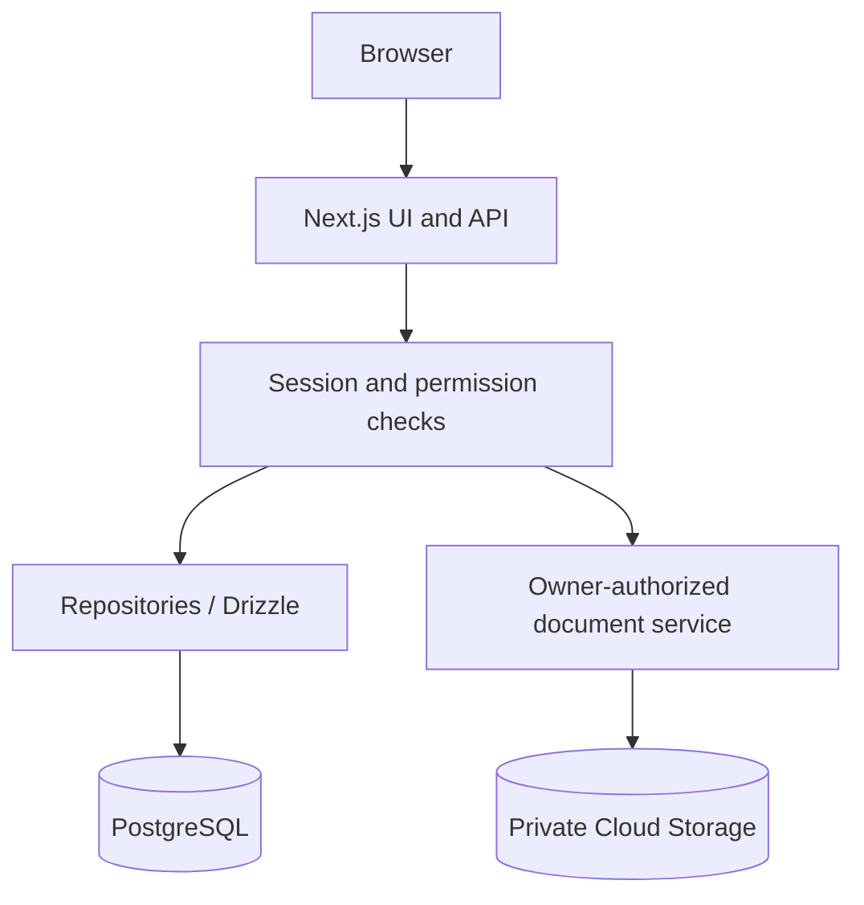
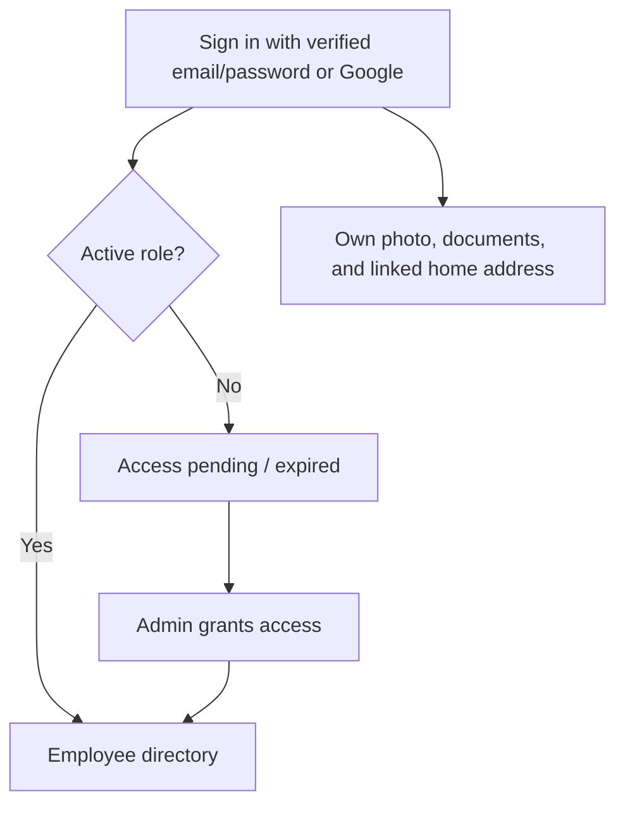

# PeopleCore Employee App

## Overview

An employee directory built with Next.js, Better Auth, PostgreSQL, and Drizzle. Browse and filter employees, manage departments and time away, and maintain personal photos, private home addresses, and PDF/DOCX documents.

## Objective

Provide a shared employee directory with role-based access and owner-controlled personal records and documents.

## Architecture



PostgreSQL stores employee data, accounts, sessions, roles, and document metadata. Document files live in a private Cloud Storage bucket; only their signed-in owner can access them. Protected requests check current access, so role expiry and account blocking take effect immediately.

Google sign-in and document uploads require their optional services to be configured. See [the configuration and operations reference](docs/configuration-and-operations.md) for architecture and API details.

## Approach

- Authenticate users with verified email/password or Google.
- Assign active roles before granting directory access.
- Apply ownership checks to employee edits and private documents.
- Store structured data through repositories and Drizzle migrations.

## Features

### Access Workflow



| Role | Access |
| --- | --- |
| Viewer | Read employees, departments, and time away. |
| Editor | Viewer access; create one employee record linked to their verified account and edit only that record. |
| Admin | Manage all employee records, departments, time away, account roles, and blocks. |

New accounts wait for an administrator to assign a role. Blocked accounts cannot sign in or use profile self-service. At least one unblocked administrator must retain permanent access. See [employee permissions](docs/employee-permissions.md) for ownership details.

## Tools

Next.js, TypeScript, Better Auth, PostgreSQL, Drizzle, Docker Compose, and optional Google Cloud services.

## How to Run

Requires Node.js/npm and Docker with Compose.

1. Run `npm ci`.
2. Copy [.env.example](.env.example) to `.env`. Set `POSTGRES_PASSWORD` and use the same password in `DATABASE_URL` (local database port: `5433`). Set a random `BETTER_AUTH_SECRET` of at least 32 characters and keep `BETTER_AUTH_URL=http://localhost:3000`.
3. Configure `RESEND_API_KEY` and a verified `VERIFICATION_EMAIL_FROM` sender for email/password registration. Alternatively, configure Google OAuth using the [authentication guide](docs/configuration-and-operations.md#authentication-setup).
4. Copy the configured `.env` to `.env.local` for Next.js and the admin bootstrap command.
5. Start the database and apply all migrations:

   ```sh
   docker-compose up -d db
   docker-compose --profile tools run --rm migrate
   ```

6. Optionally load sample employees: `docker-compose --profile tools run --rm seed`.
7. Run `npm run dev` and open [localhost:3000](http://localhost:3000).
8. Register and verify your first account (or sign in with Google), then grant it administrator access from a trusted terminal:

   ```sh
   npm run admin:bootstrap -- admin@example.com
   ```

   Replace the email with your verified account's email. Open `/admin/users` to approve other users.

For the full container stack, use `docker-compose up --build` with the configured `.env`; apply migrations when updating an existing database.

### Validation and Deployment

```sh
npm run typecheck
npm run lint
npm test
npm run build
```

`GET /api/health` checks database connectivity and returns 503 when SQL is unavailable.

For production, apply all migrations, use HTTPS, and provide secrets at runtime. Follow the [Google Compute Engine deployment guide](deploy/gcp/README.md) for Cloud SQL, Secret Manager, private document storage, and release/rollback procedures.

For optional Google Maps and document storage settings, API details, role expiry, account blocking, cleanup, and integration tests, see the [configuration and operations reference](docs/configuration-and-operations.md).

## Limitations and Next Steps

- Email/password registration requires a configured email provider and verified sender.
- Google OAuth, Maps, and private document storage require their corresponding service configuration.
- Production operation requires migrations, HTTPS, runtime secrets, and documented release and rollback procedures.

Use the linked operations and deployment guides when configuring these services.
